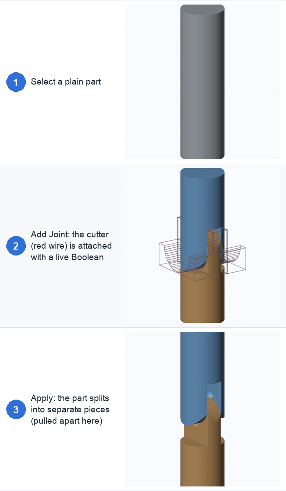

# 1. Getting started

## Install

Joint Maker needs **Blender 4.5 or newer**.

1. Download `joint_maker-<version>.zip` (or [build it yourself](08-troubleshooting.md#rebuilding-the-figures)).
2. In Blender open **Edit → Preferences → Get Extensions**, click the ▾ menu at the top right and
   choose **Install from Disk…**. Pick the zip.
3. Open the 3D View sidebar (press **N**) and click the **Joints** tab.

## Your first joint

- **Fig. 1:** Select the part (a mesh object) and look at the **Joints** tab. Pick the **axis**
  that runs along the part (X, Y or Z) and the joint type from the dropdown. For a quick start
  leave it on **Pivot**.
- **Fig. 2:** Click **Add Joint**. A cutter object is created and attached to the part with a
  live Boolean modifier. The red wireframe in the figure is that cutter. From here every setting
  updates the result immediately.
- **Fig. 3:** Click **Apply** to bake the cut. The part splits into separate pieces (pulled apart in
  the figure so you can see them). They are named `Part_A`, `Part_B`, ... in order along the
  axis; separate pins come out as `Part_Pin1`, ...

> **Tip:** the cutter is the *gap* between the pieces. Subtracting it leaves parts that don't
> touch, shaped so they can only move the way the joint allows.

## Set the units

The panel shows the part's printed size, for example `Printed size: Ø20.0 × 70.0 mm`. If that is
wrong, change **1 unit = N mm** until it matches what you will print. All clearances in the panel
are in printed millimetres, so they stay correct at any scale.

Very small parts (under 8 mm across) are assumed to print 20 mm across until you change the
value, because sub-millimetre clearances can't work on a tiny part.

## The panel at a glance

Every section folds away, and Blender remembers which ones you leave open.

| Section | What it does | Page |
|---|---|---|
| Joint type, **Add Joint** | Choose the joint, then add it to the selected part | [2](02-joint-types.md) |
| Warnings and printed size | Shown at the top whenever there is something to know | [8](08-troubleshooting.md) |
| **Placement** | Position, bend direction, tilt, offsets, gizmos | [3](03-placement.md) |
| **Size & cutting** | Joint size, taper, limit reach, fit to shape, solver | [4](04-size-and-cutting.md) |
| **Tolerances** | Gap and pin clearance | [5](05-tolerances.md) |
| **Shape** | The settings of the chosen joint type | [2](02-joint-types.md) |
| **Array** (folded) | Several joints along one part | [6](06-arrays-curves-posing.md) |
| **Placement curve** (folded) | Put the joints along a curve | [6](06-arrays-curves-posing.md) |
| **Path (pose preview)** (folded) | Pose the finished chain along a curve | [6](06-arrays-curves-posing.md) |
| **Cross-section** (folded) | Slice the result to see the inside | [7](07-cross-section.md) |
| **Info** | The sizes, clearances and range of motion that came out | |

At the bottom:

- **Show cutter** and **Show result** hide or show the cutter and the cut result in the viewport.
- **Live update** rebuilds the joint whenever a setting changes. Turn it off on heavy meshes and
  press the refresh button when you are ready.
- **Separate parts on apply** splits the result into separate objects. Turn it off to keep one
  object.
- **Apply** bakes the result. The trash button removes the joint and all its helper objects.

## Good habits

- Look at the **Info** box. It reports the actual diameters, clearances and range of motion that
  came out of your settings, and warnings appear when something is likely to fuse, break or
  collide ([what they mean](08-troubleshooting.md)).
- Use the [cross-section](07-cross-section.md) to check the inside before you apply.
- If a joint doesn't cut at all, the mesh probably isn't watertight: see
  [Solver and Repair Mesh](04-size-and-cutting.md#solver-and-repair-mesh).

Next: [Joint types →](02-joint-types.md)
