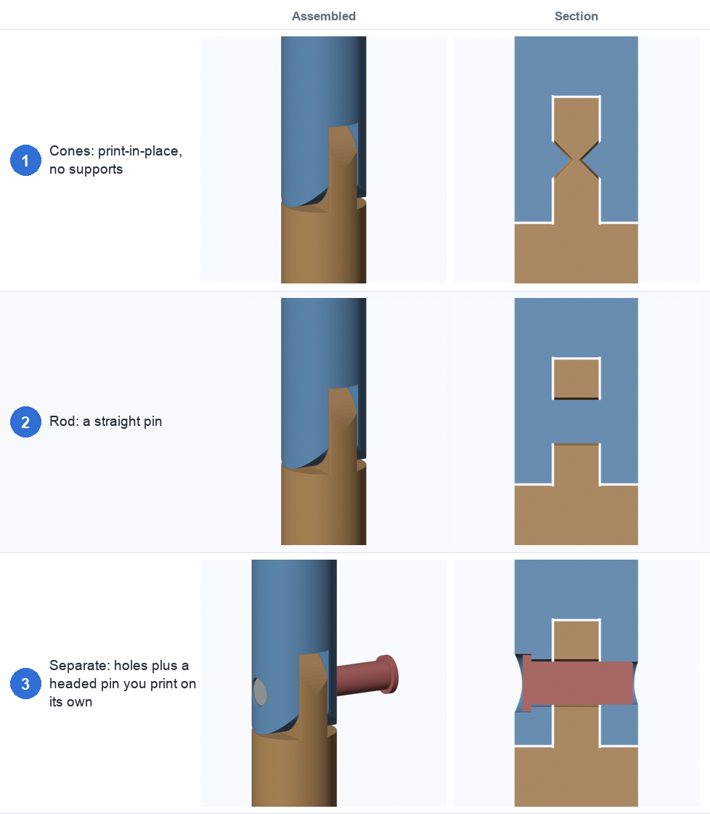
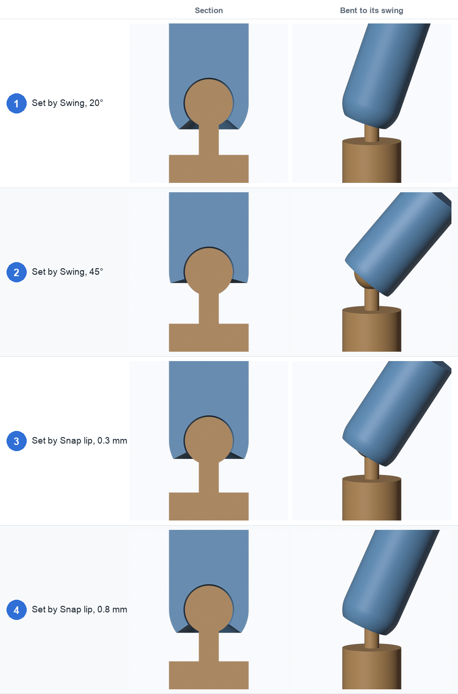
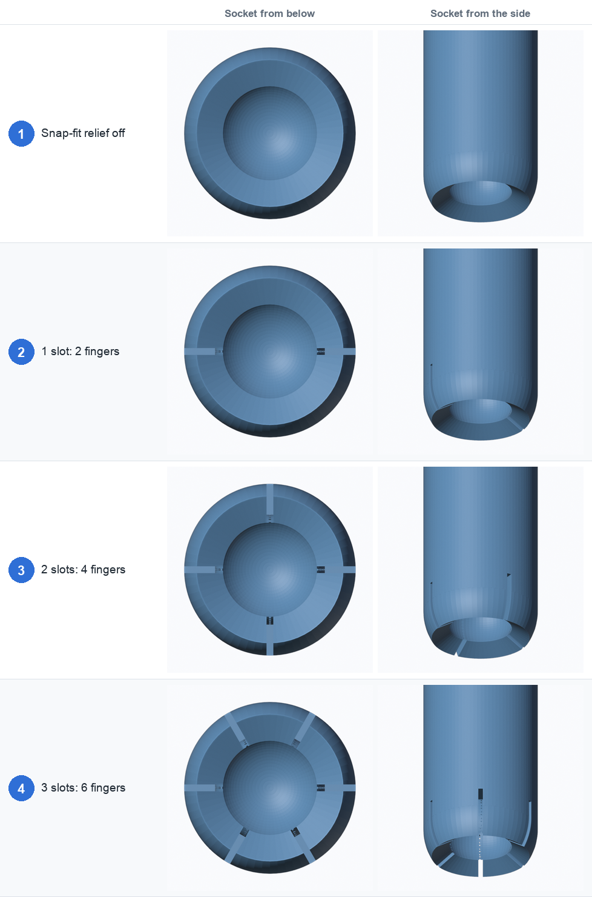
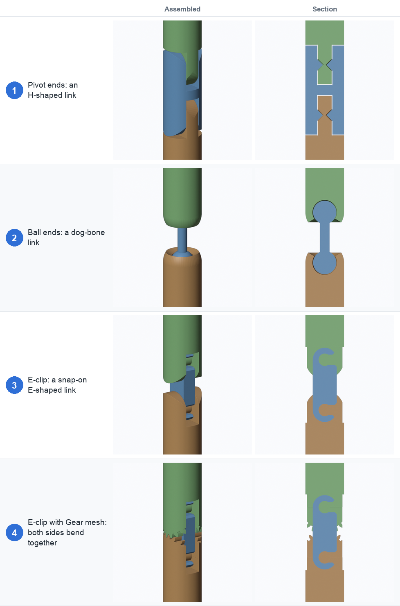
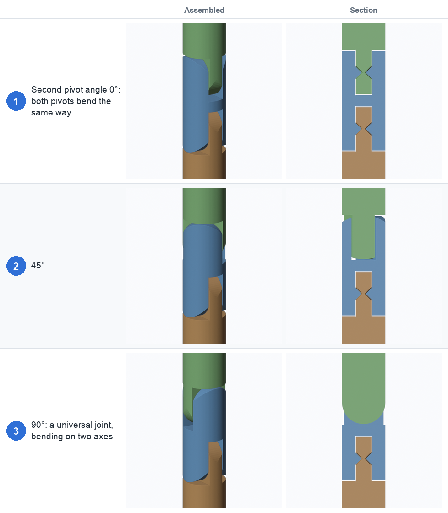
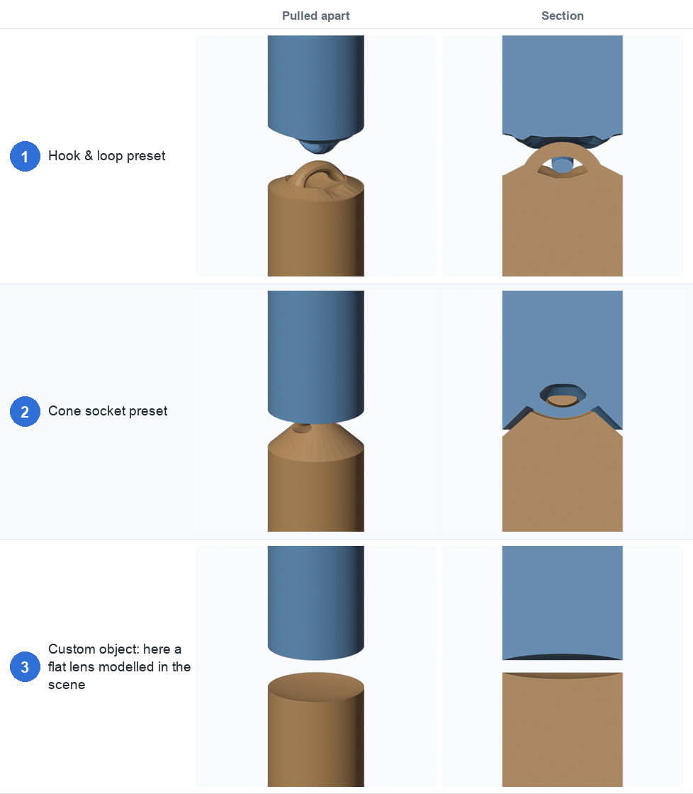

# 2. Joint types

Pick the type from the dropdown at the top of the panel (before or after **Add Joint**). The
settings for the chosen type are in the **Shape** section.

| Type | Best for | Prints |
|---|---|---|
| [Pivot](#pivot) | Knees, elbows, fingers: one axis of bend | Print-in-place, or assemble with a separate pin |
| [Ball and socket](#ball-and-socket) | Shoulders, hips, necks: any direction | Print-in-place, or snap together |
| [Double joint](#double-joint) | Knees and elbows that need a big bend | Print-in-place, or snap on a link |
| [Shape cutter](#shape-cutter) | Your own design, or the two bundled shapes | Depends on the shape |

## Pivot

A knuckle hinge: the part is cut into a tongue and a fork that swing about a pin. It bends about
**±90°**. In the **Shape** section:

| Setting | Default | What it does |
|---|---|---|
| **Tongue width** | 0.36 | How thick the middle tongue is, as a fraction of the diameter. Too narrow and the pin has no room |
| **Pin** | Cones | Cones, Rod or Separate (see below) |
| **Pin size** | 0.35 | Pin radius as a fraction of the part's radius |
| **Cone angle** | 45° | Half-angle of the cone pins. 45° or more prints without supports |
| **Press fit (mm)** | 0 | Separate pin only: extra hole diameter where the pin is gripped. If the pin won't go in, raise it to 0.1–0.2 |
| **Head clearance (mm)** | 0.4 | Separate pin only: extra diameter of the recess around the pin head |
| **Segments** | 64 | Smoothness of the round parts |

- **Fig. 1, Cones:** two cones, one in each side of the fork, point into the tongue. Print-in-place
  with no supports needed.
- **Fig. 2, Rod:** a straight pin through the tongue, joined to the fork on both sides. The
  section shows the rod as a horizontal band; the orange square above it is the tongue's rounded
  end.
- **Fig. 3, Separate:** the part gets plain holes and the pin is made as its own object (red). The
  pin turns freely in the tongue and the near side of the fork and is gripped by the far side.
  Print it separately and press it in.

## Ball and socket

A ball on a neck sits inside a domed socket. It swings in any direction and twists all the way
round.

| Setting | Default | What it does |
|---|---|---|
| **Ball size** | 0.6 | Ball radius as a fraction of the part's radius |
| **Stem size** | 0.25 | Neck thickness, as a fraction of the part's radius |
| **Set by** | Swing | Choose the swing angle, or the snap lip (see below) |
| **Swing** | 30° | How far the neck tilts before it touches the socket |
| **Snap lip (mm)** | 0.4 | How far the socket wraps past the ball's widest point. This is how much the socket must spread to snap the ball in |
| **Neck length** | 1.3 | Single ball only: ball centre to the lower body, in radii |
| **Socket wall (mm)** | 0 | Thickness of the wall around the socket. 0 keeps the full-width dome; a smaller value gives thinner, more flexible walls |
| **Snap-fit relief** | off | Slots through the socket so it can flex when you snap the ball in (see below) |

- **Fig. 1 and 2, Set by Swing:** you choose the tilt (20° and 45°). The socket mouth is sized to
  allow it. The right-hand column shows the upper part bent as far as that swing allows.
- **Fig. 3 and 4, Set by Snap lip:** you choose the interference (0.3 and 0.8 mm). The swing
  follows from it: a bigger lip holds the ball more firmly but allows less swing. The panel
  shows the swing you got. If the neck is too thick for the lip you asked for, a warning says
  there is no swing left.

A lip of about 0.3–0.6 mm is a sensible range for a snap-together ball; the panel warns outside it.

- **Fig. 1, relief off:** a solid socket. Fine for print-in-place, but too stiff to snap together.
- **Fig. 2, 3, 4, one to three slots:** the slots run from the socket mouth up past the ball
  centre, splitting the wall into 2, 4 or 6 flexible fingers. The ball and neck are never cut.
  Set the slot **width** (0.8 mm), **depth** (how far past the ball centre, 0.5) and **angle**
  to suit. A thinner **Socket wall** makes the fingers bendier.

## Double joint

Two joints joined by a link, for a bigger bend. Choose **Link ends**, then **Link length**
(the distance between the two joint centres, in radii; default 2.6).

- **Fig. 1, Pivot ends:** an H-shaped link with a fork at each end. Each pivot bends ±90°, so the
  joint folds through ±180°.
- **Fig. 2, Ball ends:** a dog-bone link with a ball at each end. It swings and twists at both ends.
  Settings are the same as for the single ball.
- **Fig. 3, E-clip:** the top and bottom parts end in forks with an axle across them. The link is
  a flat bar that looks like a rounded E from the side, and its two sockets snap onto the axles.
  The sockets open towards the side set by **Opening** (the front by default): press the link
  onto both axles from that side.
- **Fig. 4, E-clip with Gear mesh:** gears on the two forks mesh halfway between the axles, so both
  sides bend together and the link can't slip or rock.

| Setting | Default | What it does |
|---|---|---|
| **Link ends** | Pivot | Pivot, Ball or E-clip |
| **Link length** | 2.6 | Distance between the two joint centres, in radii |
| **Second pivot angle** | 0° | Pivot ends only: turn the upper pivot around the part. 90° makes a universal joint |
| **Axle size** | 0.28 | E-clip: axle radius as a fraction of the part's radius |
| **Clip wall** | 0.3 | E-clip: wall around each socket of the link |
| **Snap (mm)** | 0.3 | E-clip: how much narrower the socket mouth is than the axle |
| **Opening** | Front | E-clip: which side the sockets open towards |
| **Gear mesh** | off | E-clip: add meshing gears |
| **Tooth size (mm)** | 1.0 | Gears: the module (pitch diameter divided by tooth count) |
| **Backlash (mm)** | 0.3 | Gears: play between teeth. Printed gears need about 0.2–0.4 |

### Short links

**Link length** can go all the way down to 0, but each joint has a smallest length it can really
have: the point where the round ends can still hold their pins, or the sockets still fit. Below
the length that allows the full bend, the round ends shrink and the range of motion drops. The
panel's **Info** shows both numbers ("full range from … minimum …") and warns
"short link: bend limited to ±N°".

### Second pivot angle

- **Fig. 1, 0°:** both pivots bend the same way, in one plane.
- **Fig. 2, 45°:** the upper pivot is turned a little.
- **Fig. 3, 90°:** the pivots bend at right angles, like a universal joint. Each pivot is locked
  on the other axis.

### Gears

Each fork's prongs end in a gear (involute teeth, 20° pressure angle) centred on its axle. They
are trimmed to the part's outline, so the range is limited to where the teeth stay inside it.
The panel shows the range per side; a shorter link gives more. Warnings appear if the teeth
reach the axle or there are fewer than 10 teeth.

## Shape cutter

Use a ready-made cutout instead of a built-in joint. The shape itself becomes the cutter, so the
part splits wherever the shape passes through it.

| Setting | Default | What it does |
|---|---|---|
| **Shape** | Hook & loop | Hook & loop, Cone socket, or Custom object |
| **Shape object** | none | Custom only: any mesh in the scene |
| **Shape axis** | Z | Custom only: which axis of your mesh should line up with the part |
| **Size** | Fit | **Fit** scales the shape to the part's diameter × **Shape size** (default 1.15, a little bigger than the part so the cut goes all the way through). **Fixed** gives it an exact **Diameter (mm)** |
| **Height** | 1.0 | Stretches the shape along the part |
| **Bend limit** | 30° | How far the joint bends when you pose the chain along a path |

- **Fig. 1, Hook & loop:** two interlocked loops at 90°, like chain links. It bends on two axes.
- **Fig. 2, Cone socket:** a cone peg with a captured cross-bar head in a matching socket.
- **Fig. 3, Custom object:** here a flat lens modelled in the scene. A shape that doesn't
  interlock simply splits the part with a lens-shaped gap.

For a **custom** shape, model any closed mesh, pick it as the **Shape object** and hide it in the
viewport. The panel warns if the shape doesn't split the part (make it wider so it reaches the
outside all round).

The clearance between the pieces comes from the shape itself, so it scales with the shape. For
the two presets the panel shows the clearance you will get at your size and warns below 0.2 mm,
which may fuse when printed.

← [Getting started](01-getting-started.md) · [Placement →](03-placement.md)
