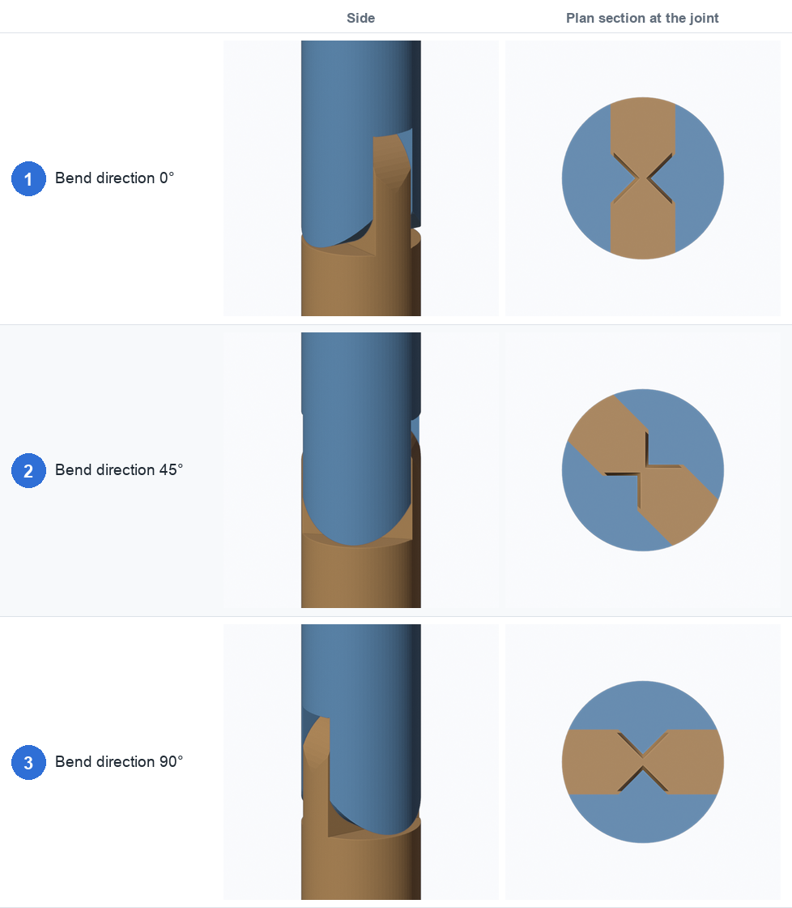
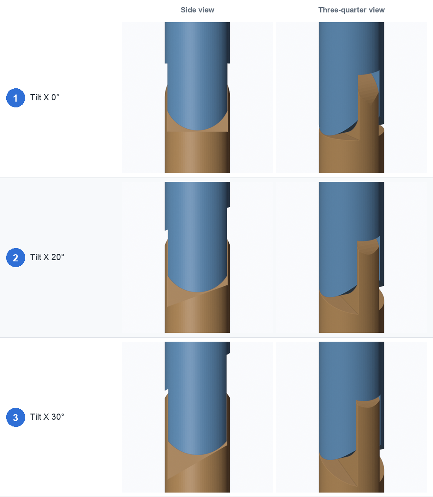
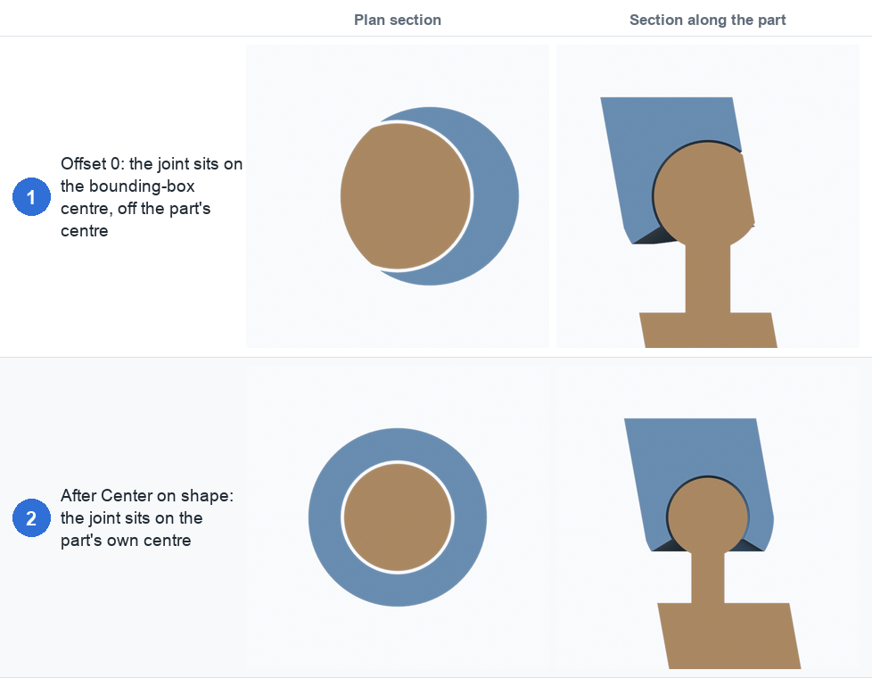
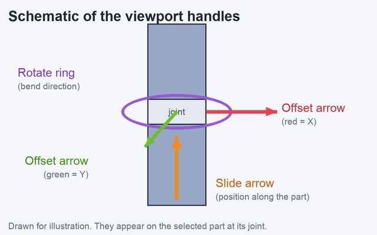

# 3. Placement

The **Placement** section decides where the joint sits on the part and which way it faces.

| Setting | Default | What it does |
|---|---|---|
| **Axis** (X / Y / Z) | Z | Which of the object's own axes runs along the part |
| **Position** | 0.5 | Where along the part the joint sits (0 = one end, 1 = the other) |
| **Position (mm)** | | The same, as a distance in printed mm from the bottom. Type an exact value. The ▼ ▲ buttons move it by **Step (mm)** |
| **Tilt X**, **Tilt Y** | 0° | Tilt the joint on its two cross axes |
| **Bend direction** | 0° | Turn the joint around the part's axis. The ↺ ↻ buttons turn it by **Step (°)** |
| **Offset** (named after the two cross axes) | 0 mm | Move the joint off-centre across the part. The ◀ ▶ buttons move it by **Step (mm)** |
| **Center on shape** / **Reset** | | Put the joint on the middle of the part's outline, or back on the bounding-box centre |
| **Step (mm)**, **Step (°)** | 1 mm, 15° | How far the nudge buttons move |
| **Flip** | off | Swap which end gets the tongue and which gets the fork |
| **Gizmos**, **Size** | on, 1.0 | Show the viewport handles, and their on-screen size |

When an [array](06-arrays-curves-posing.md) is set to **Fit**, the joint positions come from the
array, so Position is greyed out.

## Bend direction

- **Fig. 1, 0°:** the pin runs left to right, so the part bends towards and away from you.
- **Fig. 2, 45°:** the whole joint is turned a quarter of the way round the part.
- **Fig. 3, 90°:** the pin now runs front to back.

The right-hand column is a plan section through the joint: you are looking down the part at the
tongue (the X shape is the pair of cone pins) and can read off the bend direction directly.

## Tilt

- **Fig. 1, 0°:** the cut is square to the part.
- **Fig. 2, 20°:** the cut is slanted: the joint leans away from the part's axis.
- **Fig. 3, 30°:** a steeper lean.

Keep the tilt under about 35°. Beyond that the cutter leaves stray slivers, and the panel warns
"the steep tilt leaves stray slivers".

## Off-centre parts: Offset and Center on shape

The joint is placed on the middle of the part's **bounding box**. If the part leans or bulges to
one side, that isn't its real centre.

- **Fig. 1, Offset 0:** this part leans, so the bounding-box centre line misses it. The plan
  section (left) shows the ball off-centre in its ring, and the section along the part (right)
  shows the socket biting into one side.
- **Fig. 2, After Center on shape:** the joint is moved onto the middle of the part's outline at
  that height. The ring is even all round.

**Center on shape** slices the mesh at the joint and uses the outline that surrounds the joint,
ignoring any other geometry in the same mesh (an arm beside a body, say). Use **Reset** to put
the joint back on the bounding-box centre line. You can also nudge the offsets by hand with the
◀ ▶ buttons or the viewport arrows.

The two offset fields are named after the two axes that are not the part's axis. With the X axis
selected they are **Offset Y** and **Offset Z**.

### Radius from

Under **Size & cutting**, **Radius from** chooses how big the joint is. **Cross-section** (the
default) measures the part's outline right at the joint, ignoring other geometry, so a joint on a
tapering tail is sized for the tail at that spot. **Bounding box** measures the whole object,
which is how earlier versions worked.

## Viewport gizmos

With a joint active, handles appear on the selected part. They keep a fixed size on screen
however you zoom, and the **Size** slider next to **Gizmos** makes them bigger or smaller.

- **Orange slide arrow:** drag it along the part to move the joint. It is hidden when an array
  is set to Fit or a placement curve is in use.
- **Purple rotate ring:** drag it round the joint to turn the bend direction.
- **Red and green offset arrows:** drag them across the part to move the joint off-centre (red is
  the object's X axis, green is Y, blue is Z). They are hidden when a placement curve is in use.

The figure above is a drawn schematic: handles can't be photographed in a background render.

← [Joint types](02-joint-types.md) · [Size and cutting →](04-size-and-cutting.md)
