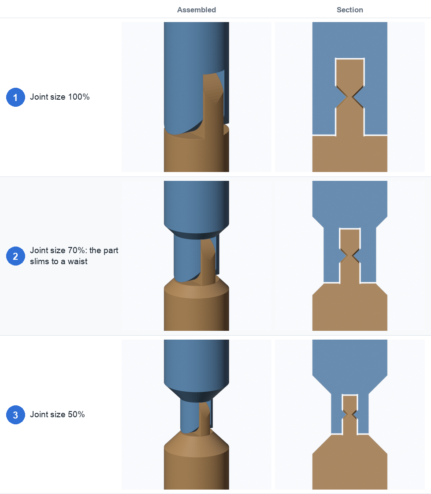
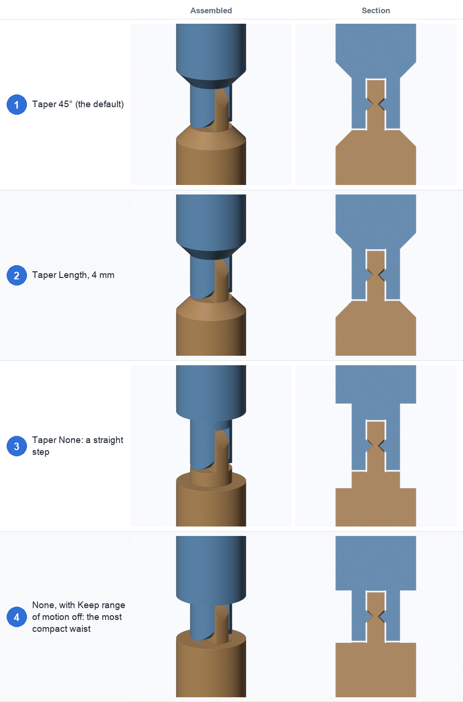
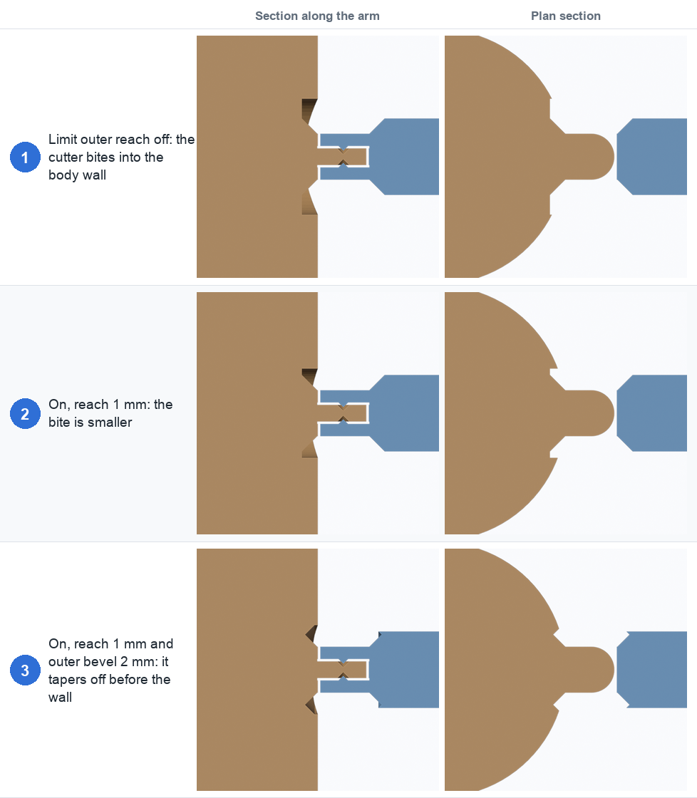
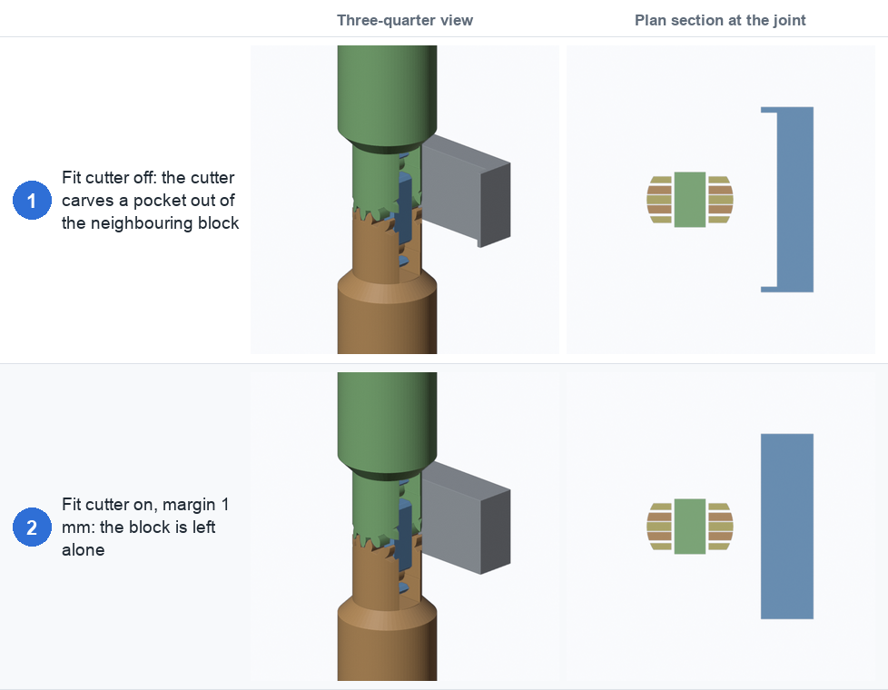
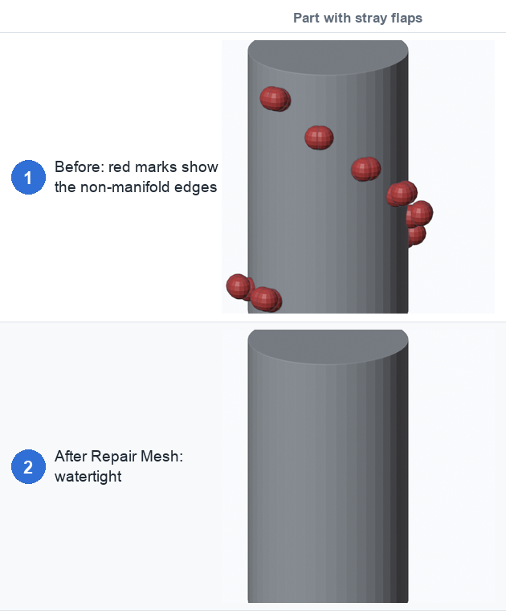

# 4. Size and cutting

The **Size & cutting** section controls how big the joint is compared with the part, and how
tightly the cutter is trimmed to it.

| Setting | Default | What it does |
|---|---|---|
| **Radius from** | Cross-section | Measure the part at the joint, or use the whole bounding box |
| **Joint size** | 100% | Scale the joint's features relative to the part (30–100%) |
| **Taper** | 45° | How the slimmed waist widens back out: 45°, Length, or None |
| **Taper length (mm)** | 3 | Length of the taper when Taper is Length |
| **Keep range of motion** | on | Add a straight neck so the full bend range survives |
| **Solver** | Auto | Auto, Manifold or Exact |
| **Limit outer reach** | off | Trim every cutter piece to a tube just past the part's surface |
| **Reach past surface (mm)** | 1 | How far past the surface the cutters may reach |
| **Outer bevel (mm)** | 0 | Chamfer the outer ends of that tube |
| **Fit cutter to shape** | off | Trim the cutters to a tight hull around the part |
| **Margin (mm)** | 1 | How far that hull reaches past the surface |

## Joint size and taper

Below 100% the joint is smaller than the part, so the part **slims to a waist** around the joint
and widens back to full size beyond it.

- **Fig. 1, 100%:** the joint fills the part.
- **Fig. 2, 70%:** the part slims around the joint, and the pivot inside it is smaller. Clearances
  stay in millimetres, so the fit doesn't change.
- **Fig. 3, 50%:** a smaller joint again. At this size the pin and fork are thin, so watch the
  warnings.

How the waist widens back out is the **Taper**:

- **Fig. 1, 45°:** a 45° slope. It prints without supports and gives the full range of motion.
- **Fig. 2, Length (4 mm):** a shorter slope that you set yourself.
- **Fig. 3, None:** a straight step. The full-width body only returns far enough out that it
  can't collide when the joint bends.
- **Fig. 4, None with Keep range of motion off:** the most compact waist. The bend range drops, and
  the panel says by how much.

**Keep range of motion** adds a straight neck so the full-width body returns only where it can't
collide when the joint bends. Turn it off when space matters more than range.

## Limit outer reach

The cutter reaches well beyond the part's surface. On a part that is part of something bigger,
like an arm growing out of a body, it can cut into the neighbouring geometry: a shoulder joint
bites a notch out of the armpit.

**Limit outer reach** trims every cutter piece of the joint to a tube around it. The tube's
outer diameter is the part's own cross-section at the joint plus **Reach past surface**. So the
cutters stop just past the arm's surface instead of reaching the body.

- **Fig. 1, off:** the cutter bites a notch into the body wall beside the arm. The left column is a
  section along the arm; the right is a plan section.
- **Fig. 2, on, reach 1 mm:** the bite is much smaller.
- **Fig. 3, on, reach 1 mm and outer bevel 2 mm:** the **Outer bevel** chamfers the ends of the
  waist's outer wall, so the cut tapers off before it reaches the body.

The outer bevel shapes the ends of the waist, so it has an effect when **Joint size** is under
100%. A bigger bevel costs some bend range. The panel notes this, and the
[cross-section](07-cross-section.md) shows the clearance. If you use a large bevel and stray
slivers appear, the panel warns "the outer bevel leaves stray slivers": use a smaller bevel.

The panel also shows the resulting **waist pipe wall** thickness.

## Fit cutter to shape

**Fit cutter to shape** trims the cutters to a hull built from slices of the part at the
joint, plus a **Margin**. Only the outline that surrounds the joint is used, so other geometry
in the same mesh doesn't count.

- **Fig. 1, off:** a block of geometry (grey) sits next to the part. The cutter carves a pocket
  out of it. The plan section on the right shows the block with its side bitten away.
- **Fig. 2, on, margin 1 mm:** the block is left alone.

If something outside the hull still joins the parts across the joint, the panel warns "parts
still joined": raise the margin. For a part growing out of a larger body, use
[Limit outer reach](#limit-outer-reach) as well, because a slice at the shoulder is one
continuous outline running from the arm into the body.

## Solver and Repair Mesh

The cut uses Blender's boolean modifier. The **Manifold** solver is fast and robust, but it only
works on **watertight** meshes: on anything else it quietly does nothing, and nothing is cut.

| Solver | What it does |
|---|---|
| **Auto** (default) | Manifold when the mesh is watertight, otherwise Exact, with a warning |
| **Manifold** | Always the fast solver. Nothing is cut if the mesh isn't watertight |
| **Exact** | Slower, but copes with meshes that aren't watertight |

When the mesh has problems the panel shows the number of non-manifold edges and a **Repair Mesh**
button. It is undoable and edits the object's mesh.

- **Fig. 1, before:** stray flaps (tiny fins of faces stuck to the surface, typical sculpting or
  remeshing leftovers) make the mesh non-manifold. The red marks show where the bad edges are.
- **Fig. 2, after Repair Mesh:** the flaps are gone and the mesh is watertight, so the fast solver
  works again.

Repair Mesh:

1. merges duplicate vertices,
2. detaches small stray flaps (up to 50 faces) and deletes them,
3. removes interior faces,
4. drops loose edges and vertices,
5. welds near-duplicate vertices on open edges and fills small holes (up to 32 sides), and
6. makes the normals consistent.

It never remeshes. If it can't fix everything, the report says how many bad edges remain
(find them with **Select → All by Trait → Non Manifold**). On big meshes in the Exact solver a
rebuild can take several seconds, so turn **Live update** off while you adjust settings.

← [Placement](03-placement.md) · [Tolerances and printing →](05-tolerances.md)
