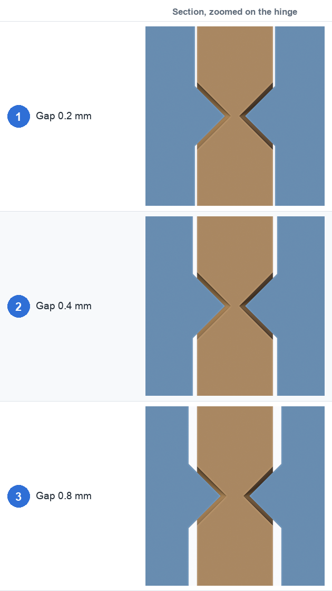
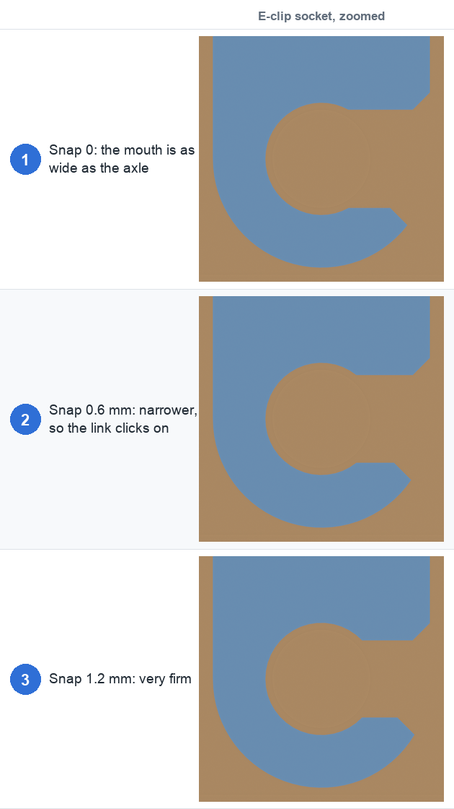

# 5. Tolerances and printing

Every clearance in Joint Maker is in **printed millimetres**, so it stays right at any scale
(set **1 unit = N mm** first, see [Getting started](01-getting-started.md#set-the-units)).

The defaults suit a typical filament printer with a 0.4 mm nozzle. They are starting points:
every printer, material and slicer behaves a little differently, so print one test joint
before you print a whole figure.

## The clearance settings

| Setting | Where | Default | What it controls |
|---|---|---|---|
| **Gap (mm)** | Tolerances | 0.40 | The space between faces that slide past each other |
| **Pin clearance (mm)** | Tolerances | 0.40 | The space between a pin and the hole it turns in |
| **Press fit (mm)** | Shape (Pivot, Separate pin) | 0 | Extra diameter of the hole that *grips* a separate pin |
| **Head clearance (mm)** | Shape (Pivot, Separate pin) | 0.4 | Extra diameter of the recess around a pin head |
| **Snap lip (mm)** | Shape (Ball) | 0.4 | How far a ball socket wraps past the ball: the snap-in interference |
| **Snap (mm)** | Shape (E-clip) | 0.3 | How much narrower the E-clip socket mouth is than the axle |
| **Backlash (mm)** | Shape (E-clip gears) | 0.3 | Play between gear teeth |

**Gap** is the main one for print-in-place joints. Too small and the parts fuse into one lump;
too big and the joint is sloppy.

- **Fig. 1, 0.2 mm:** tight. It needs a well-tuned printer, or it will fuse.
- **Fig. 2, 0.4 mm:** the default.
- **Fig. 3, 0.8 mm:** loose and floppy, but forgiving on a rough printer.

(The section is zoomed in on the hinge so the gap is visible.)

## Snap-in parts

For parts you press together, the amount of squeeze matters.

- **Fig. 1, snap 0:** the socket mouth is as wide as the axle, so the link just drops on and off.
- **Fig. 2, snap 0.6 mm:** the mouth is narrower than the axle, so the link clicks on and stays.
- **Fig. 3, snap 1.2 mm:** very firm. It may crack in a stiff material.

The same idea applies to the ball and socket: the **Snap lip** is the interference, and a lip
of about 0.3–0.6 mm is a good range. Add [snap-fit relief slots](02-joint-types.md#ball-and-socket)
and a thinner **Socket wall** so the socket can flex.

## Tips

- **Separate pins won't go in:** printed holes usually come out a little small. Raise **Press
  fit** to about 0.1–0.2 mm.
- **A print-in-place joint is stuck:** the gap has fused. Raise **Gap** and **Pin clearance** a
  little, and make sure the first layers aren't squashing the gap shut.
- **Orientation:** print the pivot with its pin axis horizontal so the cone pins don't need
  supports. Print gears lying on their side so the teeth outlines are flat on the bed.
- **Material:** a tougher filament such as PETG tolerates snapping better than a brittle one.
- **Thin features:** the add-on keeps walls at least about 0.8 mm. If the panel warns about a thin
  clip wall, socket wall or prong, make the part or the joint bigger rather than the walls
  thinner.
- **Check before you print:** the [cross-section](07-cross-section.md) shows the real gaps and
  the **Info** box lists the clearances that came out.

← [Size and cutting](04-size-and-cutting.md) · [Arrays, curves and posing →](06-arrays-curves-posing.md)
