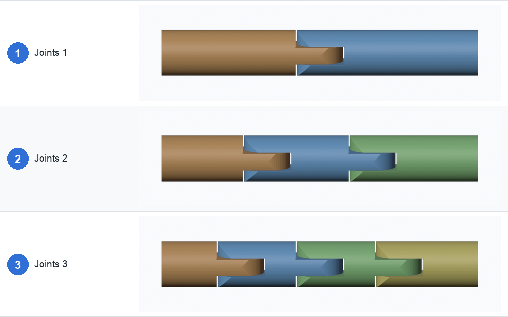
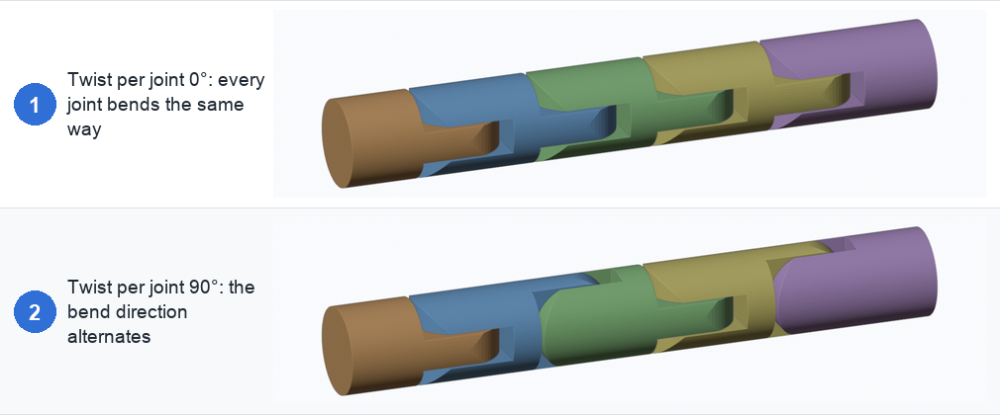
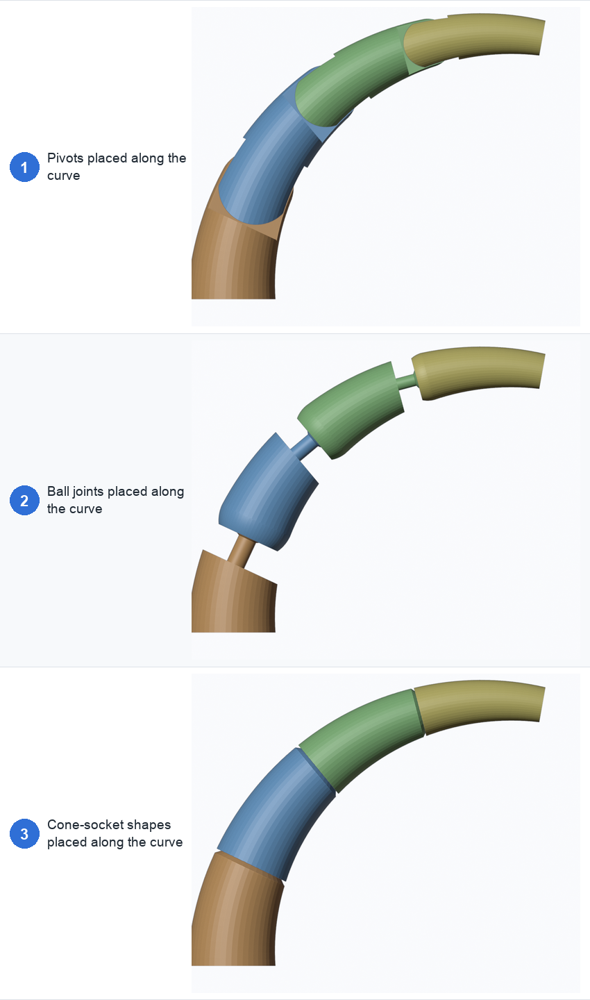
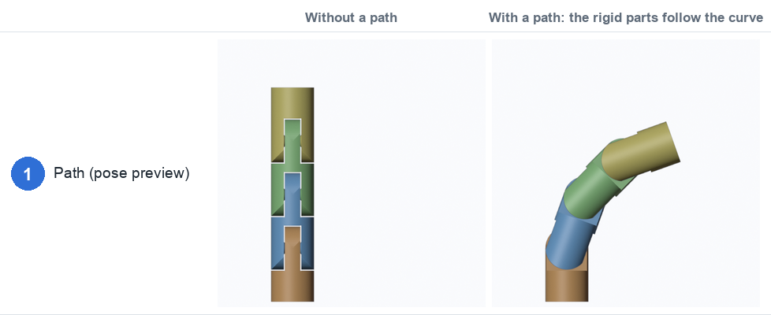

# 6. Arrays, curves and posing

These three sections are folded by default. They are about several joints on one part, and how
they are laid out.

| Section | What it does |
|---|---|
| **Array** | Put several joints on one part |
| **Placement curve** | Place those joints along a curve, each one square to it |
| **Path (pose preview)** | Lay the finished chain along a curve to see how it moves |

## Array

| Setting | Default | What it does |
|---|---|---|
| **Joints** | 1 | How many joints (1–100) |
| **Spread** | Fit | **Fit** spaces the joints so all the parts are the same length. **Spacing** uses a fixed distance centred on **Position** |
| **Spacing (mm)** | 30 | Distance between joint centres, for Spacing |
| **Twist per joint** | 0° | Turn each joint this much further than the one before |

- **Fig. 1, 1 joint:** a single hinge.
- **Fig. 2, 2 joints:** the part splits into three pieces.
- **Fig. 3, 3 joints:** four pieces, evenly spaced.

Every joint type works in an array, and separate pins are made for each joint. The panel shows
the solid material left between neighbouring joints, and warns when joints overlap or leave less
than 1 mm between them.

- **Fig. 1, twist 0°:** every joint bends the same way, so the chain curls in one plane.
- **Fig. 2, twist 90°:** the bend direction alternates, so the chain can curl in 3D, like a
  tentacle or a snake.

## Placement curve

An array on a straight part places its joints on the part's axis. For a **curved or tapering**
part that isn't enough: the joints must sit on the part's own centre line and face along it.

Pick a **curve object** as the **Placement curve** and the array's joints are placed along it.
Each joint sits on the curve with its axis pointing along the curve, and takes its size from the
part's cross-section at that spot, so joints shrink towards the tip of a cone.

| Setting | Default | What it does |
|---|---|---|
| **Placement curve** | none | The curve to follow |
| **Start**, **End** | 0, 1 | Limit the joints to part of the curve |
| **Snap to section centre** | on | Move each joint onto the middle of the part's cross-section where it sits |

The joint count, spread and spacing still come from the **Array** section.

- **Fig. 1, Pivots:** three hinges along the tail's curve, each cut square to the tail.
- **Fig. 2, Ball joints:** the same curve with balls.
- **Fig. 3, Cone-socket shapes:** the same curve with a [shape cutter](02-joint-types.md#shape-cutter).

In this example the curve is drawn 1.5 mm off the tail's centre. With **Snap to section centre**
on, each joint still lands on the middle of the tail. Turn it off and the joint stays on the
curve, and the panel warns when that leaves a stray sliver.

An object holds one joint setup, so it follows one curve. For a mesh with several appendages,
separate each into its own object (in Edit Mode, **Separate → By Selection**) and give each its
own curve.

Placement-curve joints use the part's outline at each spot, so the panel warns if a joint's
parts don't separate. While a placement curve is set, the slide and offset gizmo arrows are
hidden, and path posing is switched off.

## Path (pose preview)

The **Path** is a different job. It doesn't place anything: it takes the finished chain of
joints and lays it along a curve so you can see **how the cuts move**. The parts stay rigid;
only the joints bend, and each is limited to its own range of motion.

| Setting | Default | What it does |
|---|---|---|
| **Path** | none | The curve to pose along |
| **Roll** | 0° | Spin the chain around its axis on the path |
| **Hide straight** | on | Show the straight part as wire while it is posed |

- **Without a path:** three hinges on a straight part.
- **With a path:** the rigid parts follow the curve, each joint bending as far as it can.

If the path is too tight for the joints, the panel warns "path too tight at N joint(s): bend
capped at the joint limit", and "chain runs into itself on this path" if the posed parts would
collide. A **shape cutter** uses its **Bend limit** setting for this. **Apply** gives you the
parts already posed along the path.

← [Tolerances and printing](05-tolerances.md) · [Cross-section →](07-cross-section.md)
