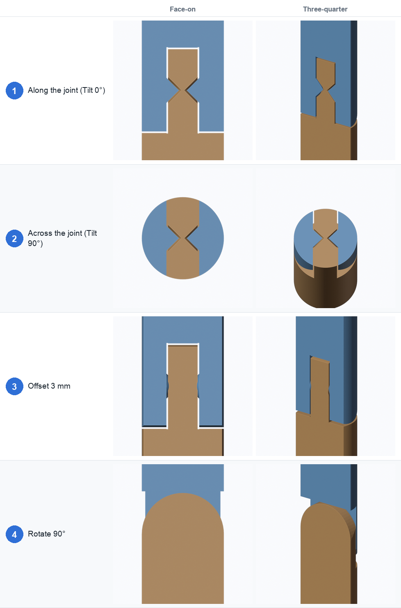

# 7. Cross-section

The **Cross-section** section (folded by default) slices the live result with a plane and
shows the inside. It is the quickest way to check that the gaps, pins and sockets are what you
meant before you print.

Turn on **Show cross-section**. The slice updates whenever the joint changes. Each part has its
own colour, matching the figures in these docs: the lower part is orange, the next blue, then
green and so on, and a separate pin is red. The cut faces are filled in.

| Setting | Default | What it does |
|---|---|---|
| **Show cross-section** | off | Show or remove the slice |
| **Joint** | 1 | Which joint to slice, when there are several |
| **Offset (mm)** | 0 | Move the plane along its normal |
| **Rotate** | 0° | Turn the plane around the joint's axis |
| **Tilt** | 0° | Tip the plane: 0° slices along the joint, 90° slices across it. The **Along** and **Across** buttons set these two |
| **Flip side** | off | Keep the other half |
| **Hide model** | on | Show the model as wireframe, and hide whole pins, while the section is on |

The plane always goes through the joint's centre; **Offset**, **Rotate** and **Tilt** move it
from there.

- **Fig. 1, Along (tilt 0°):** the plane runs along the part and through the pin: the best view of
  how the tongue, fork and pin fit. The left column looks straight at the cut; the right shows
  the half-model from the side.
- **Fig. 2, Across (tilt 90°):** the plane cuts across the part at the joint, so you look down at
  the joint's footprint. It shows the bend direction and the shape of the cutter.
- **Fig. 3, Offset 3 mm:** the plane is moved off the pin's axis, so the pin is only cut near its
  edge. Use it to look past the middle.
- **Fig. 4, Rotate 90°:** the plane is turned a quarter-turn around the part, giving the view from
  the other direction.

## Uses

- **Check a gap:** zoom in on the section and compare the gap with what you set (see
  [Tolerances](05-tolerances.md)).
- **Check a snap:** a section through an E-clip or a ball shows how much the socket wraps the
  axle or ball.
- **Check trimming:** with [Limit outer reach](04-size-and-cutting.md#limit-outer-reach) or
  [Fit cutter to shape](04-size-and-cutting.md#fit-cutter-to-shape), look for how much of the
  neighbouring geometry the cutter touches.
- **Check an array:** use **Joint** to step through each joint of an array.

The preview is only a view: it never changes your part. Switching it off, Apply, or Remove
deletes it and puts the model's display back.

← [Arrays, curves and posing](06-arrays-curves-posing.md) · [Troubleshooting →](08-troubleshooting.md)
