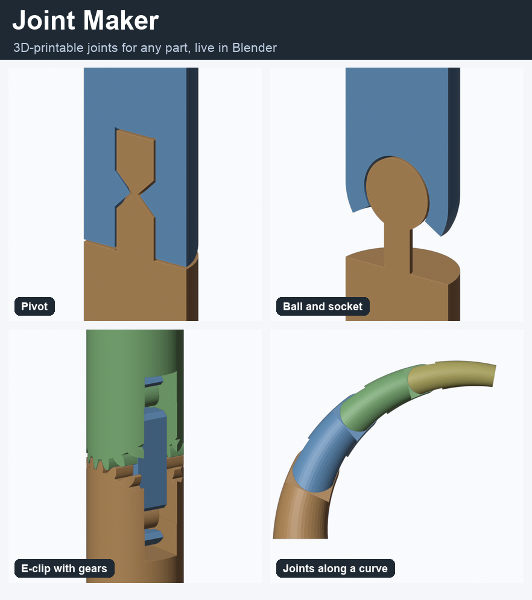

# Joint Maker documentation

Joint Maker turns a part such as a limb, tail, finger or tube into a 3D-printable joint. You
choose a joint type and tune it in a sidebar panel, with a live preview. **Apply** then splits the
part into separate pieces that print interlocked or snap together.

New here? Start with **[Getting started](01-getting-started.md)** and have a look at the
snapshots: each page shows what a setting does to the geometry.

## Contents

| Page | What's in it |
|---|---|
| [1. Getting started](01-getting-started.md) | Install, units, adding a joint, the panel at a glance, Apply |
| [2. Joint types](02-joint-types.md) | Pivot, ball and socket, double joints (pivot, ball, E-clip, gears), shape cutter |
| [3. Placement](03-placement.md) | Position, bend direction, tilt, offsets, Center on shape, gizmos |
| [4. Size and cutting](04-size-and-cutting.md) | Joint size and taper, limit outer reach, fit cutter, solver and Repair Mesh |
| [5. Tolerances and printing](05-tolerances.md) | Gaps, pin clearance, press fit, snap, backlash, printing tips |
| [6. Arrays, curves and posing](06-arrays-curves-posing.md) | Several joints on one part, joints along a curve, path pose preview |
| [7. Cross-section](07-cross-section.md) | Slicing the live result to check the inside |
| [8. Troubleshooting](08-troubleshooting.md) | What each warning means and what to change |

## How to read the figures

Wherever a setting has several options (a dropdown, a switch, a few useful values), the
figure stacks them top to bottom. The numbered badge on each row matches the **Fig. 1, 2, 3**
list under the image. Most rows show the result in two ways: the parts coloured by position
along the joint, and a **section** (a slice through the middle).

In these images the lower part is orange, the next one blue, then green and so on. A separate
pin is red.

The snapshots are made by a script from the add-on itself, so they stay true to what it does.
See [Rebuilding the figures](08-troubleshooting.md#rebuilding-the-figures).
